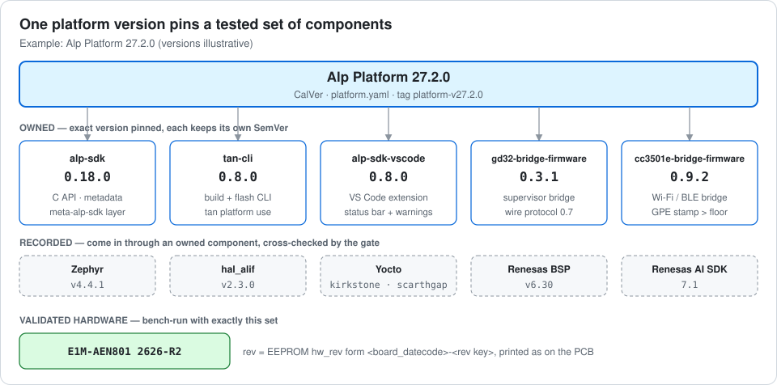
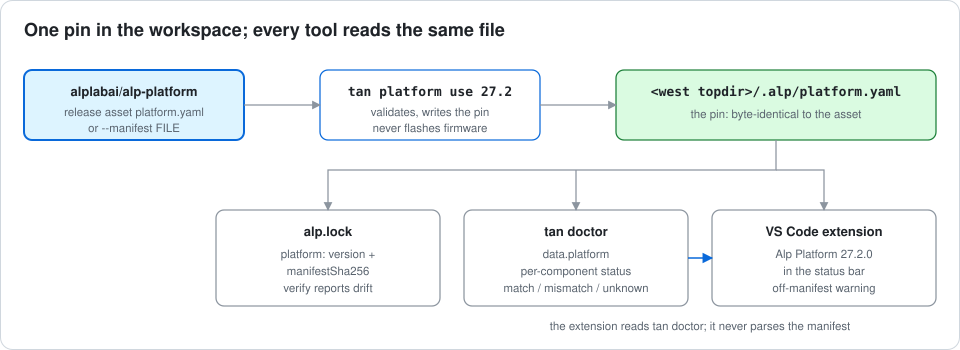
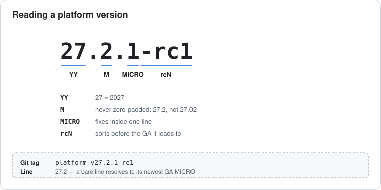
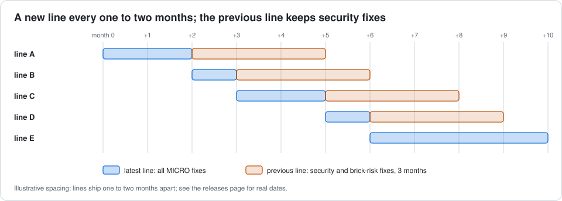

# Alp Platform

**One version number for a tested Alp Lab software stack.**

An Alp Platform release names a set of component versions that Alp Lab has built and
bench-validated together on real modules: the Alp SDK, the `tan` build CLI, the VS Code
extension, and the GD32 and CC3501E bridge firmware. Instead of matching five version
numbers by hand, you pin one platform line, for example `26.11`.



Each component keeps its own SemVer and its own compatibility gates. The platform
version adds a name and a tested set on top; it never replaces a component version.

## Releases

| Line | Status | Released | Manifest |
| --- | --- | --- | --- |
| 26.11 | In preparation | planned November 2026 | `platform-v26.11.0` once tagged |

Every release is a GitHub release in this repo, tagged `platform-v<version>`, with the
manifest `platform.yaml` attached.

## Quick start

Pin a workspace to a platform line, then check it:

```sh
tan platform use 26.11      # newest 26.11.x; or a full version such as 26.11.0
tan doctor                  # reports the platform and any off-manifest component
tan platform show           # what the workspace is pinned to
tan platform clear          # remove the pin
```

- `tan platform use` writes the manifest to `<west topdir>/.alp/platform.yaml`.
  `alp.lock` then records the platform version and the manifest hash, so a lock file
  names the tested set it was built from.
- The VS Code extension shows `Alp Platform <version>` in the status bar and warns when
  a component in the workspace differs from the manifest.
- While this repo is private, fetching a manifest needs a `GITHUB_TOKEN` with read
  access. Offline, use `tan platform use --manifest platform.yaml`.

> **Nothing is flashed.** Pinning a platform never writes firmware to a board. Bridge
> firmware versions are reported; programming a board stays an explicit, separate step.



## Version format



`YY.M.MICRO[-rcN]`, for example `26.11.0`, `26.11.1`, `26.11.0-rc1`.

- `YY` is the two-digit year and `M` the month the line's `.0` release shipped.
- The month is never zero-padded: `27.2.0`, not `27.02.0`. A padded month is refused
  with the unpadded form named, because SemVer forbids leading zeros and Python
  packaging (PEP 440) rewrites them.
- `MICRO` counts fixes inside one line, from 0. A fix shipped later keeps the line's
  name: `26.11.3` is still the November 2026 line.
- A line is `YY.M` (`26.11`). A bare line resolves to its newest non-rc MICRO; an rc is
  only used when named in full. `-rcN` sorts before the GA release it leads to.

## Cadence and support

A new line ships every one to two months, when a bench-validated set is ready. The first
line is 26.11 (November 2026).



| Line | Gets |
| --- | --- |
| Latest | every MICRO fix |
| Previous | security and brick-risk fixes, for three months after the next line ships |
| Older | nothing; move to a newer line |

## What may change inside a line

| Change to a component | In a MICRO (26.11.0 to 26.11.1) | Needs a new line |
| --- | --- | --- |
| PATCH release (bug fix) | yes | no |
| MINOR release (new API, new board) | no | yes |
| MAJOR release or ABI break | no | yes, called out in the release notes |
| GD32 or CC3501E wire-protocol change | no | yes |
| Zephyr, hal_alif or Yocto series bump | no | yes |
| Security or brick-risk fix that needs a MINOR | yes, under the conditions in [RELEASING.md](RELEASING.md#micro-vs-new-line) | no |
| Adding a validated hardware revision | yes | no |
| Removing a validated hardware revision | no | yes |

## What a manifest contains

Schema: [`schema/alp-platform-v1.schema.json`](schema/alp-platform-v1.schema.json).
Example: [`examples/platform.example.yaml`](examples/platform.example.yaml) (placeholder
versions).

| Key | Meaning |
| --- | --- |
| `platform` | the platform version, e.g. `26.11.0` |
| `released` | release date of this MICRO |
| `components` | exact versions of alp-sdk, tan-cli, alp-sdk-vscode, gd32-bridge-firmware (with its wire protocol) and cc3501e-bridge-firmware (with its GPE stamp and floor) |
| `recorded` | upstream versions that come in through the SDK: Zephyr, hal_alif, Yocto series, Renesas BSP and AI SDK |
| `validated_hw` | the module revisions this set was bench-run on, in the form the module EEPROM and PCB carry, e.g. `E1M-AEN801` `2626-r2` |
| `bench_evidence` | link to the hardware-in-the-loop run (optional) |

> **CC3501E warning.** Flashing a CC3501E GPE stamp at or below the floor a part has
> already seen permanently bricks the bridge. Every manifest check refuses
> `gpe_stamp <= gpe_floor`.

## Repository layout

| Path / ref | Contents |
| --- | --- |
| `main` | tooling: schema, `tools/`, tests, workflows, docs |
| `line/<YY.M>` | one branch per line, with `platform.yaml` at the root |
| tag `platform-v<version>` | one per release; its GitHub release carries `platform.yaml` byte-identical to the tagged file |
| `tools/platform_manifest.py` | manifest loader and checker (CLI below) |
| `docs/images/` | diagrams, generated by `python docs/images/gen_diagrams.py` (edit the script, not the SVGs) |

## Checking a manifest

```sh
pip install -r requirements-dev.txt
python tools/platform_manifest.py check platform.yaml            # offline
python tools/platform_manifest.py check platform.yaml --online   # needs GITHUB_TOKEN
python tools/platform_manifest.py check platform.yaml --online --json
python -m pytest -q                                              # tool tests
```

Exit 0 = all checks pass, 1 = a check failed, 2 = usage error or unreadable file.

- **Offline:** schema, version grammar, a real release date, the CC3501E stamp above its
  floor. YAML aliases and files over 64 KiB are refused.
- **Online**, read from each component repo at its `v<version>` tag:
  - every component has a published release;
  - the extension's `MIN_SDK_VERSION` is at or below the pinned SDK;
  - tan-cli's supported build-plan `schemaVersion` equals the SDK's;
  - each validated revision exists in the SDK's `hw-revisions.yaml`, matches the
    family's `board_datecode`, is buildable, and its SDK bounds include the pinned SDK;
  - `recorded` Zephyr and hal_alif match the SDK's `west.yml`, and the Yocto series
    match `meta-alp-sdk`'s `LAYERSERIES_COMPAT`;
  - the GD32 protocol major matches the SDK host driver;
  - the released CC3501E image (`cc3501e-v<version>.bin`) really carries the manifest's
    `gpe_stamp`, read from the image header, and that stamp is above `gpe_floor`.

CI runs the tests on `main` and the online check on every `line/**` push and PR.

## Releasing

See [RELEASING.md](RELEASING.md): components release first, the manifest is checked and
bench-validated, and the platform tag comes last.

## Related repositories

| Repository | Role in the platform |
| --- | --- |
| [alplabai/alp-sdk](https://github.com/alplabai/alp-sdk) | C API, board metadata, Yocto layer; records the pin in `alp.lock` |
| [alplabai/tan-cli](https://github.com/alplabai/tan-cli) | `tan platform use` / `tan doctor` |
| [alplabai/alp-sdk-vscode](https://github.com/alplabai/alp-sdk-vscode) | status bar item and off-manifest warning |
| [alplabai/gd32-bridge-firmware](https://github.com/alplabai/gd32-bridge-firmware) | supervisor bridge firmware |
| [alplabai/cc3501e-bridge-firmware](https://github.com/alplabai/cc3501e-bridge-firmware) | Wi-Fi / BLE bridge firmware |

Signex and the alp-lab plugin are design and developer tools with their own release
lines; they are not part of the platform.

## License

Apache-2.0. Copyright 2026 Alp Lab AB.
