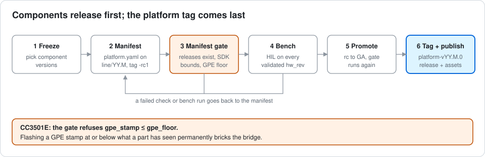
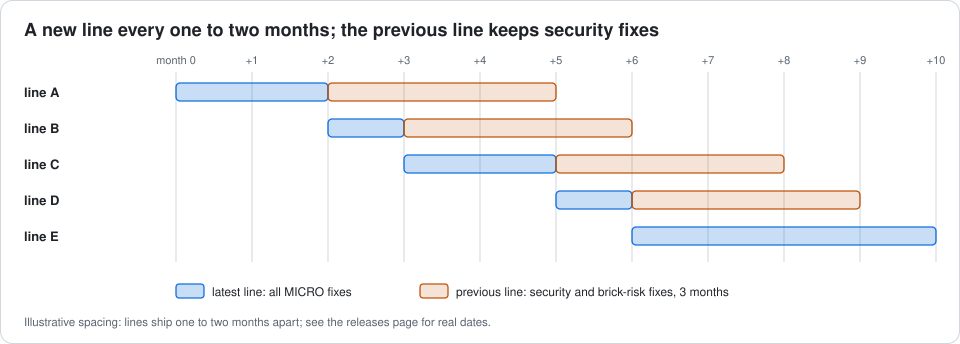

# Releasing an Alp Platform line

Components always release before the platform tag.

1. **Freeze** about two weeks before the planned release date. Each component cuts its own release
   through its own flow (alp-sdk, tan-cli, alp-sdk-vscode, gd32-bridge-firmware,
   cc3501e-bridge-firmware).
2. **Write the manifest.** Branch `line/YY.M` from `main`, add `platform.yaml` at the root
   (start from `examples/platform.example.yaml`), set `platform: YY.M.0-rc1`, run the gate
   (step 3) and only then tag `platform-vYY.M.0-rc1`.
3. **Run the gate.** `python tools/platform_manifest.py check platform.yaml --online`
   (CI runs it on every push and PR to `line/**`). Fix the manifest until it passes. The
   gate checks the GD32 protocol **major** only; the minor is not verified, so confirm it
   against the firmware by hand.
4. **Bench-validate** every `validated_hw` rev: build with tan from the manifest, run the
   HIL suite **serially** on labgrid-reserved boards (one board at a time, reserve before
   use), and link the evidence in `bench_evidence`.
5. **Promote** components from rc to GA, update the manifest, re-run the gate. Re-bench
   only a component whose binary changed.
6. **Tag `platform-vYY.M.0`.** The `release` workflow checks the tag equals `platform`,
   re-runs the online gate, verifies the tagged commit is on `origin/line/YY.M`, and publishes the release with `platform.yaml` as an asset.
   Add the component table and prebuilt images to the release page.

## Cadence

A new line ships every one to two months, when a bench-validated set is ready; it takes the month it ships in. The first line is 26.11 (November 2026). The latest line gets every MICRO fix; the previous line gets security and brick-risk fixes for three months after the next line ships.

There is no long-term line for now; one is added only when a customer needs it.

## Component releases for 26.11

Every component cuts a new release for 26.11, and each must stay compatible with the
others in the set (the online gate checks the SDK bounds, the tan build-plan schema, the
extension's `MIN_SDK_VERSION` and the GD32 protocol). tan-cli first ships 0.7.1 GA from
its current release candidate, then the `tan platform` work as 0.8.0, which is the tan
in 26.11. Validated hardware for 26.11: `E1M-AEN801` `2626-r2`.

**Before tagging `platform-v26.11.0`, make this repository public**, so customers can
fetch manifests without a token.

## MICRO vs new line

A MICRO may take component PATCH releases and add a validated `hw_rev`. A component MINOR
or MAJOR, any ABI break, a bridge wire-protocol change, or a Zephyr / hal_alif / Yocto
bump needs a new line.

**Security and brick-risk exception.** A MICRO may take a component MINOR release only
when all of these hold:

- it fixes a security issue or a risk of damaging hardware (a bricked part, an
  out-of-range rail, flash wear), and a PATCH backport is not practical;
- it adds no ABI break, no wire-protocol change and no Zephyr / hal_alif / Yocto bump;
- it is bench-validated on every `validated_hw` revision of the line;
- the release notes name the MINOR and why it was needed.

Anything else waits for the next line. Modules in the field stay on a line for its
whole support window, so a fix that keeps them safe must not force a migration.

## CC3501E brick warning

Flashing a CC3501E GPE stamp at or below the floor the part has already seen
**permanently bricks the bridge**. The gate refuses any manifest with
`gpe_stamp <= gpe_floor`; never bypass it, and never raise `gpe_floor` above a stamp you
have not confirmed on the part. Raise the floor only after the new image is flashed and
verified on the bench.

## CI token

The five component repos are public, so the default `GITHUB_TOKEN` can read them. The
workflows prefer an optional `PLATFORM_GATE_TOKEN` secret when it is set, for example to
avoid API rate limits or if a component repo becomes private.
